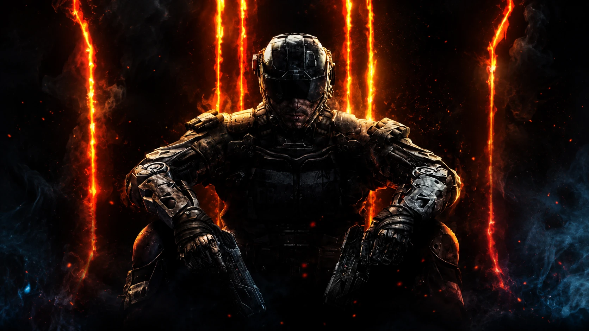

# Aether Archives — Geheimakte 115

Um arquivo interativo sobre o universo Zombies de **Call of Duty: Black Ops III**, criado por **Erick Augusto** como projeto pessoal de portfólio.

A ideia nasceu do interesse pelo jogo: planejar e começar um site que reunisse mapas, personagens, histórias e mecânicas em uma experiência própria. O resultado combina uma apresentação cinematográfica com seis dossiês navegáveis e interações inspiradas em cada mapa.

[**Explorar o site**](https://augstconsagrado.github.io/aether-archives-bo3/) · [**Conhecer o estudo de UI/UX**](https://augstconsagrado.github.io/aether-archives-bo3/ui-ux.html) · [**Abrir a apresentação em PDF**](portfolio/Aether_Archives_UI_UX_Case_Study.pdf)



## O que explorar

A página inicial apresenta uma vitrine rotativa dos mapas, personagens de Morg City e uma cronologia do Aether. Cada dossiê reúne contexto, personagens, equipamentos, mecânicas, etapas da missão e segredos, com uma identidade visual própria.

| Dossiê | Experiência interativa |
| --- | --- |
| [Shadows of Evil](https://augstconsagrado.github.io/aether-archives-bo3/mapa.html?id=shadows-of-evil) | Beast Mode, distritos e rituais |
| [The Giant](https://augstconsagrado.github.io/aether-archives-bo3/mapa.html?id=the-giant) | Rede de teletransportes |
| [Der Eisendrache](https://augstconsagrado.github.io/aether-archives-bo3/mapa.html?id=der-eisendrache) | Caminhos dos arcos elementais |
| [Zetsubou No Shima](https://augstconsagrado.github.io/aether-archives-bo3/mapa.html?id=zetsubou-no-shima) | Laboratório e experimentos |
| [Gorod Krovi](https://augstconsagrado.github.io/aether-archives-bo3/mapa.html?id=gorod-krovi) | Console de cerco e desafios |
| [Revelations](https://augstconsagrado.github.io/aether-archives-bo3/mapa.html?id=revelations) | Fragmentos e constelação dimensional |

## Recursos da interface

- Navegação entre os seis mapas, com menu adaptado para telas menores.
- Fichas de personagens, galeria de imagens e módulos de conteúdo.
- Checklist da missão e progresso das interações salvos no navegador quando o armazenamento local está disponível.
- Interações específicas por mapa, em vez de repetir o mesmo componente em todos.
- Navegação por teclado, foco visível, link para pular ao conteúdo e respeito à preferência de movimento reduzido.
- Página de apresentação de UI/UX e material em PDF, complementando o site funcional.

A interface foi construída para computador e celular. A apresentação móvel é parte do site responsivo; não se trata de um aplicativo nativo para iOS ou Android.

## Construção

O projeto usa **HTML, CSS e JavaScript**, sem framework e sem etapa de build. O conteúdo dos dossiês fica separado da renderização em dados estruturados. Temas por mapa, componentes reutilizados e estados de progresso conectam a identidade visual ao conteúdo.

Não há conta de usuário nem sincronização entre aparelhos. O progresso fica somente no navegador usado para visitar o site. Apoio de IA foi utilizado durante o desenvolvimento e a documentação.

### Arquivos principais

| Caminho | Responsabilidade |
| --- | --- |
| `index.html` | Apresentação, mapas, personagens e cronologia |
| `mapa.html` | Estrutura compartilhada dos dossiês |
| `js/main.js` | Navegação e experiências da página inicial |
| `js/map.details.js` | Renderização dos mapas, interações e progresso |
| `data/map.json` | Conteúdo editável dos seis dossiês |
| `js/map-data.js` | Cópia dos dados para abertura local sem depender de fetch |
| `css/global.css`, `css/map.css` | Identidade, componentes e adaptação de layout |
| `assets/images/` | Imagens e referências visuais |
| `ui-ux.html`, `portfolio/` | Apresentação do projeto e PDF |
| `404.html` | Página de arquivo não encontrado |

A publicação usa os arquivos da **raiz do repositório**. As pastas aninhadas existentes contêm outras cópias; não são necessárias para abrir a versão principal.

## Executar localmente

Clone o repositório e sirva a raiz com um servidor estático, como o Live Server do VS Code:

```bash
git clone https://github.com/AugstConsagrado/aether-archives-bo3.git
cd aether-archives-bo3
```

Também é possível abrir `index.html` diretamente. Ao alterar `data/map.json`, atualize `js/map-data.js` para manter os dois conteúdos sincronizados.

## Contexto do portfólio

Este é um projeto de iniciativa pessoal, motivado pelo interesse no jogo. Não representa uma encomenda de cliente nem resultados comerciais. Demonstra organização de conteúdo, direção visual, interfaces responsivas e experiências interativas em JavaScript.

Projeto independente e não oficial. Call of Duty e os elementos do jogo pertencem aos respectivos titulares. Veja [NOTICE.md](NOTICE.md).
